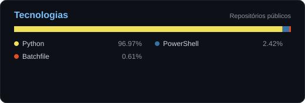

# 👋 Olá, eu sou Eduardo

💻 Estudante de programação, criando projetos para aprender e evoluir.

## 🚀 Projetos

### 🤖 [RoboAVA-Luna](https://github.com/Eduardodev065/RoboAVA-Luna)
Aplicativo em Python com interface gráfica e integração com a API da OpenAI.

### 🎮 Below — As Profundezas Vazias
Jogo de exploração de masmorra com combates por turnos.

## 🛠️ Tecnologias

Estou sempre aprendendo e trabalhando em novos projetos.
